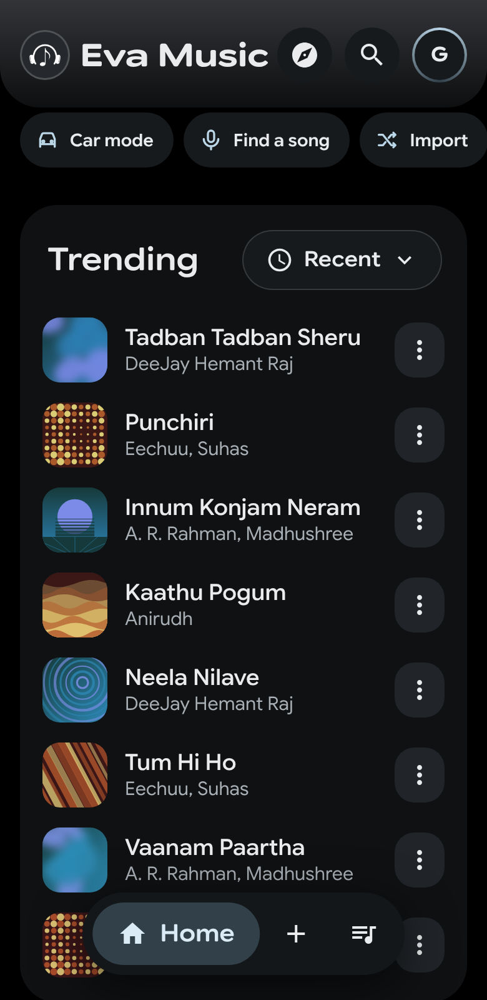
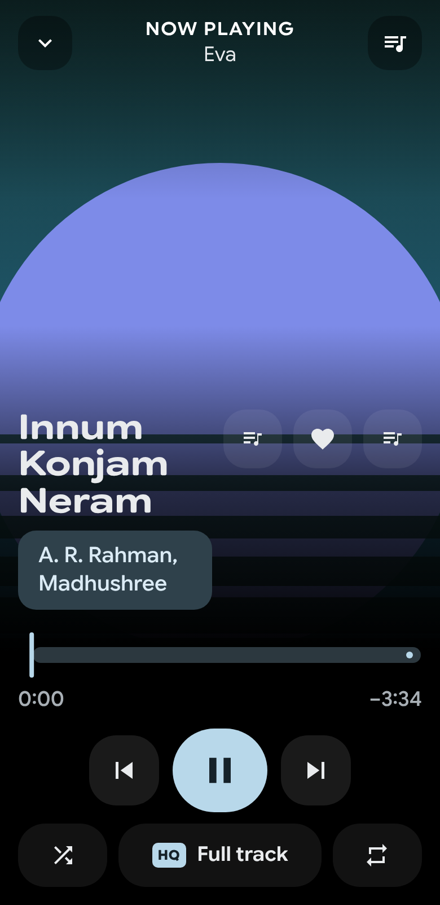
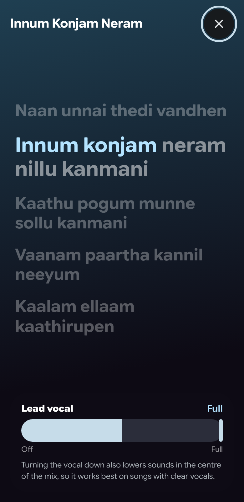
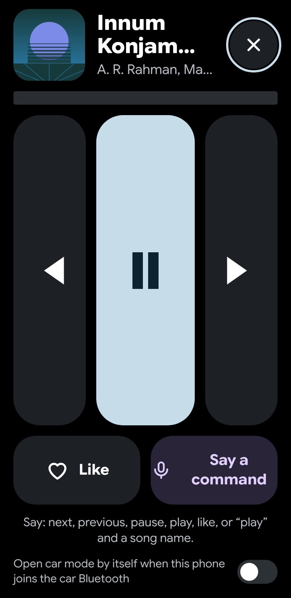
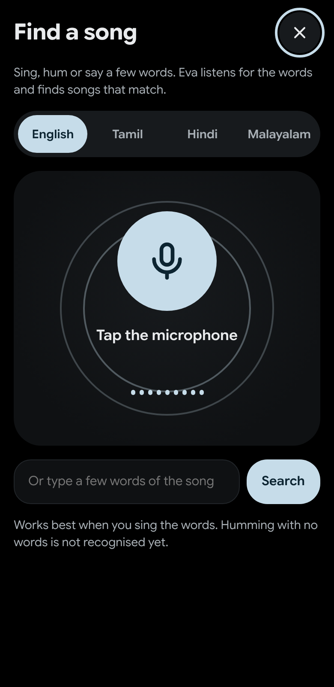
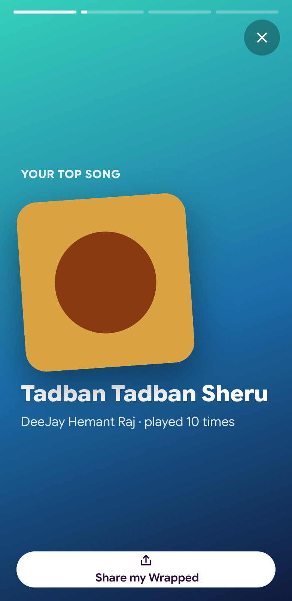
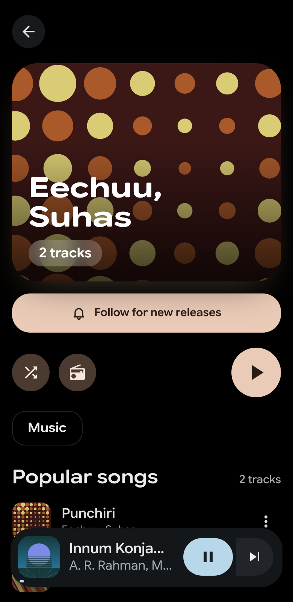
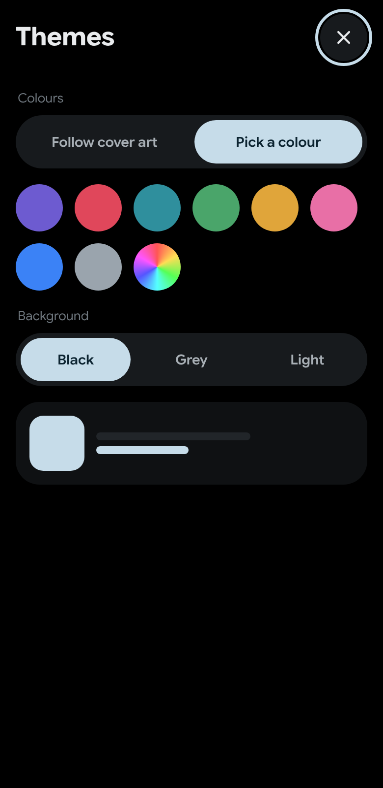

<p align="center"></p>

# Eva Music

*Feel the music.* A music player for Android with its own front end.

Search any song, play it full length, sing along with lyrics that light up in time, drive hands-free,
and keep everything on your phone. Updates arrive inside the app.

---

## Showcase

<table>
  <tr>
    <td></td>
    <td></td>
    <td></td>
  </tr>
  <tr>
    <td align="center"><b>Home</b><br>Trending Tamil, Hindi and Malayalam</td>
    <td align="center"><b>Player</b><br>Full-length songs, cover art</td>
    <td align="center"><b>Karaoke</b><br>Words light up, vocal turned down</td>
  </tr>
  <tr>
    <td></td>
    <td></td>
    <td></td>
  </tr>
  <tr>
    <td align="center"><b>Car mode</b><br>Huge buttons and voice</td>
    <td align="center"><b>Find a song</b><br>Sing or say a few words</td>
    <td align="center"><b>Eva Wrapped</b><br>Your year in music</td>
  </tr>
  <tr>
    <td></td>
    <td></td>
    <td></td>
  </tr>
  <tr>
    <td align="center"><b>Artists</b><br>Follow for new releases</td>
    <td align="center"><b>Themes</b><br>Your colour, your background</td>
    <td align="center"><b>Import</b><br>Bring playlists from YouTube or Spotify</td>
  </tr>
</table>

---

## Features

<table>
<tr>
<td valign="top" width="50%">

### Playback
- Full-length streaming, no ads
- Background playback with notification and lock-screen controls
- Next and previous from the notification, headset and widget
- Sleep timer: 15 to 60 minutes, or end of the song
- Queue, shuffle, repeat and autoplay

### Lyrics and karaoke
- Synced lyrics with word-by-word highlight
- Karaoke mode with a lead vocal slider

### Library
- Liked songs, playlists and history saved on your device
- Optional account sign-in to back up your library and settings
- Import playlists from a YouTube or Spotify link, or a list of songs

</td>
<td valign="top" width="50%">

### Discover
- Trending: Tamil 50%, Hindi 25%, Malayalam 25%
- Search by song, artist or album
- Find a song by singing or saying a few words (English, Tamil, Hindi, Malayalam)
- Follow artists, browse popular songs and albums, get new release alerts

### Personal
- Themes: colours follow the cover art or a colour you pick
- Black, grey or light backgrounds
- Eva Wrapped: top song, minutes and favourite language, ready to share

### Everywhere
- Home screen widget: play, next, like and sleep timer
- Car mode with huge buttons and voice control, opens when your phone joins the car Bluetooth
- In-app software updates

</td>
</tr>
</table>

---

## Build

The `build-apk` GitHub Actions workflow builds a debug APK on every push to `main` and
attaches it to the **latest** release. To build locally:

```
./gradlew :app:assembleDevDebug
```

The APK is written to `app/build/outputs/apk/dev/debug/`. Requires JDK 21 and the Android SDK.

## Licence

Eva Music is free software under the GNU General Public License v3.0 (see `LICENSE`).
Third-party components and their notices are listed in `NOTICE`.
